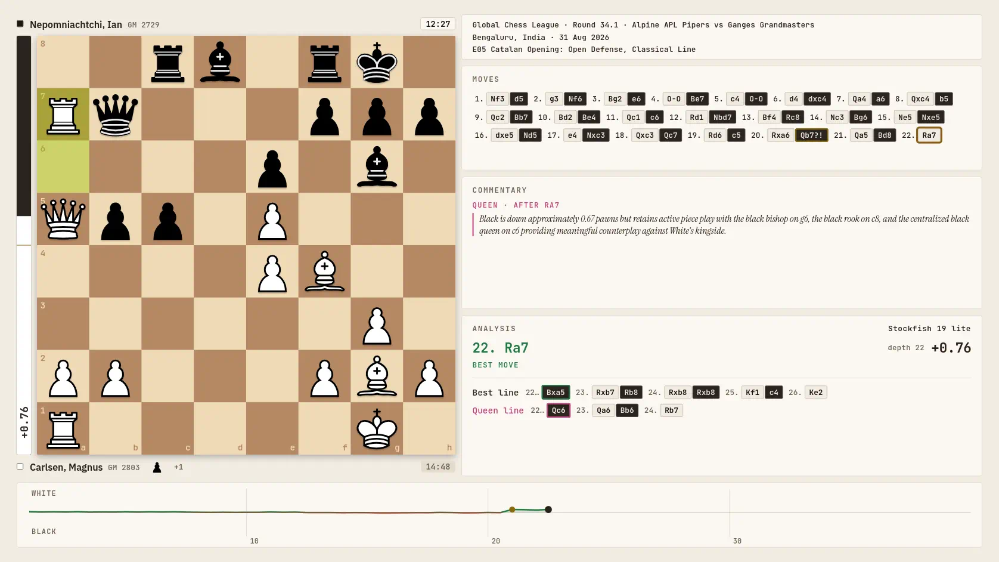

# Chess Replay

A browser app for replaying and playing chess games, at https://chess-replay.onrender.com/. Everything runs in the browser, Stockfish included, and keeps working offline once loaded (React, html2canvas and the fonts come from CDNs on the first visit and are then kept). Going online is limited to Ask Queen, Lichess (the endgame tablebase, on by default; the cloud evaluation and the opening explorer, off by default; see [Lichess data](#lichess-data); and a Lichess game link you paste), and the full Stockfish and the board reader when you ask for them.

## Features

- **Replay a game**: load a PGN (a `[FEN]` start position or a Chess960 game too) and step through it on an animated board, with an evaluation graph, a rating for every move, the best line and the opening name
- **Analysis in the browser**: Stockfish 19 analyses games that come without evals; drag a piece to try your own move from any position. Live searches (your moves, the free board, the move paused on) run once the Analysis panel's Stockfish switch is on (off by default). The 1.8 MB lite engine runs by default; the engine drop-down in the Analysis panel offers the full engine (99 MB, downloaded once and kept in the browser). Where the page is cross-origin isolated (the Render site) Stockfish searches with several threads, and the Analysis panel's ☰ sets the threads, hash, lines and time or depth
- **Lichess game import**: paste a lichess.org game, study or broadcast link in Import game and its PGN is fetched from Lichess
- **Opening explorer**: the book moves from each position (Lichess's opening tables)
- **Lichess opening explorer** (off by default): the games played from each position, with counts and results, from Lichess or its masters database; needs a Lichess sign-in (see [Lichess data](#lichess-data))
- **Endgame tablebase**: with 7 pieces or fewer, the result with best play and every move ranked by it, from Lichess's tablebase; a game's analysis takes those positions from it too, rating each move by whether it keeps the win or the draw (needs a connection; Settings › Online turns it off)
- **Explore** (the dock's Menu): a board from the starting position, a Chess960 position or a position set up by hand (or from a FEN) in Edit position, where Stockfish rates every move
- **Position from image**: a screenshot, a diagram or a photo of a board read into Edit position by a board reader that runs in the browser (56 MB, downloaded once when you ask and kept), with the picture beside the board and the squares it is unsure of outlined; the picture isn't sent anywhere
- **Play vs human**: a game for two at one screen, from the starting position, a Chess960 position, the position on the board, one set up in Edit position or one read from a picture. The board turns to the side to move, moves can be taken back, and the game ends on mate, a draw by the rules or by agreement, or resignation, with optional clocks. Stockfish stays off until it ends
- **Play vs computer**: a game against Stockfish, a chess engine, at full strength, as White, Black or a random side, with Take back and optional clocks. Three hints a game show Stockfish's best move; Stockfish quietly flags inaccuracies, mistakes and blunders, and the better move shows once the game is over
- **My games**: every game is kept in the browser from its first move; the 50 most recent are listed, to resume one in progress or replay a finished one like a loaded game (analysis, PGN and video export included)
- **Ask Queen**: a commentary on the position from queen-pawn-8, a chess language model on a Hugging Face Space (needs a connection)
- **Export**: any game, or a stretch of it, as an MP4 or WebM video (with the move sounds, in a chosen quality, optionally at a variable frame rate) or an animated WebP (a chosen width and quality, up to lossless), at 8 to 30 frames a second; it records the page as you see it, so the text size and layout carry over
- **Layouts for every screen**: one responsive page, a board with a sidebar on a wide window and one column on a narrow one, with a Text size setting; light or dark to match the system; full screen where the browser allows it, and Add to Home Screen opens it as an app
- **Move sounds**: a synthesized Wood set and five of Lichess's sets
- **Offline**: a service worker keeps the page, the engine and everything they load

https://github.com/user-attachments/assets/f10da682-fd69-4c6c-adec-42d95d294677

## Lichess data

With Settings › Online › Endgame tablebase on (the default), the position on the board, as a FEN and nothing else (no account, no game), goes to Lichess's tablebase at `https://tablebase.lichess.ovh/standard` whenever it has 7 pieces or fewer: while a replay is paused, and on the free board, never during a game. "Analyse with Stockfish" sends the game's positions of 7 pieces or fewer one by one as the run reaches them, to `/standard`, 1 s apart. With Settings › Online › Lichess cloud evaluation on (off by default), the positions Stockfish searches for your own moves (the free board, moves you try in the replay) go to `https://lichess.org/api/cloud-eval` as FENs (and a loaded analysis's position when you press Go deeper on it, or once the Analysis panel's Stockfish switch has searched it), one at a time, 300 ms after the board last changed; never a game's analysis or a game against Stockfish. Answers are kept in memory for the page's lifetime only.

With Settings › Online › Lichess opening explorer on (off by default), the position on the board, as a FEN and nothing else, goes to `https://explorer.lichess.ovh/lichess` (or `/masters`) whenever the free board's position changes, with your Lichess token: Lichess answers only signed-in requests. Sign in with Lichess (OAuth, no scopes, so the token can read nothing of your account) or paste a personal token; the token stays in this browser and goes only to Lichess. Sign out removes it.

A lichess.org game, study or broadcast link pasted in Import game fetches that game's PGN from `lichess.org`, with no token; nothing else is sent.

## Build

Needs Node 22 or later; nothing to install (Babel and Stockfish are in the repo) and no network.

1. `git clone https://github.com/boneyland/chess-replay && cd chess-replay`
2. `node build.cjs`, which writes `out/site/` (Render builds it from this repo, `render.yaml`, and serves it at https://chess-replay.onrender.com/): `chess-game-video.html`, plus the Stockfish and WebP encoder files (`.js` and `.wasm`, loaded from next to the page), the service worker `sw.js`, a web app manifest with its icons (from `app/icons/`), so Add to Home Screen opens it without the browser's bars, and the link-preview image `og-image.png`
3. Serve `out/site/` over HTTP, e.g. `python3 -m http.server 8765 --directory out/site`, and open http://localhost:8765/chess-game-video.html (don't open the file directly: browsers won't load the engine from a `file://` page)

Hosting `out/site/` anywhere static works the same. Ask Queen's Hugging Face sign-in only returns to URLs registered with an OAuth app, so on your own host it calls Queen without signing in, unless you register an app and put its client ID in `HF_OAUTH` (`app/queen.jsx`); a static Hugging Face Space with `hf_oauth: true` in its README supplies its own.

## Tests

- `node --test --test-concurrency=1 tests/*.test.cjs`: the JS tests (GitHub Actions runs them on every push to main and every pull request, and the Render build before building)
- `../chess-animator/.venv/bin/python -m unittest tests/check_browser_json.py` (from the repo root, after the JS tests): checks the browser's analysis against the Python pipeline. It imports chess-animator, which must be checked out next to this repo; `make_rating_expected.py` and `make_openings_expected.py` regenerate the fixtures from the Python code. Building doesn't need chess-animator
- `node --test tests/live/site.test.cjs`: smoke tests of the live site (or `LIVE_URLS=local`, a local build) in Chromium and Firefox with Playwright; GitHub Actions runs them on each push against that commit's build, in WebKit too (iPhone Safari's engine); `node --test tests/live/android.test.cjs`: a few phone checks in Chrome on an Android device over adb, which GitHub Actions runs on an emulator
- `node media/record-demo.cjs`: re-records `media/demo.mp4`, the video above (needs Playwright and ffmpeg)

## Layout

What each file and folder is, the vendored files' sources and their SHA-256 checksums: see [LAYOUT.md](LAYOUT.md).

## Credits

Built into the page or served with it:
- [Stockfish](https://stockfishchess.org/) 19, as [stockfish.js](https://github.com/nmrugg/stockfish.js) by Nathan Rugg (GPL-3.0)
- Colin M.L. Burnett's chess pieces, the `cburnett` set as on Lichess (GPL-2.0-or-later)
- 26 more piece sets from [Lichess's source](https://github.com/lichess-org/lila), unchanged (`vendor/pieces/`, chosen in Settings › View › Pieces): merida by Armando Hernandez Marroquin (GPL-2.0-or-later), chessnut by Alexis Luengas (Apache-2.0), fantasy, spatial and celtic by Maurizio Monge (MIT), rhosgfx by RhosGFX (CC0), kiwen-suwi by neverRare and firi by James Faure (CC BY 4.0), letter by usolando, pirouetti by pirouetti and pixel by therealqtpi (AGPL-3.0-or-later), mpchess by Maxime Chupin (GPL-3.0-or-later); and, non-commercial, staunty, maestro, fresca, cardinal, icpieces, gioco, tatiana and dubrovny by sadsnake1, california by Jerry S., caliente by avi, cooke by fejfar, minimal-warmth by blunder_reign and anarcandy by caderek ([CC BY-NC-SA 4.0](https://creativecommons.org/licenses/by-nc-sa/4.0/)) and xkcd by Randall Munroe ([CC BY-NC-SA 2.5](https://xkcd.com/license.html)): a video exported with one may not be used commercially, as the Share and export dialog says
- 20 board pictures and the board menu's tiles from [Lichess's source](https://github.com/lichess-org/lila), unchanged (`vendor/boards/`, chosen in Settings › View › Board), by the lila authors and pirouetti (AGPL-3.0-or-later)
- Lichess's [chess-openings](https://github.com/lichess-org/chess-openings) tables (CC0)
- The futuristic, nes, piano and sfx move sounds by [Enigmahack](https://github.com/Enigmahack), from [Lichess's source](https://github.com/lichess-org/lila) (AGPL-3.0-or-later)
- The lisp move sounds by [EdinburghCollective](https://lichess.org/@/EdinburghCollective), unchanged from [Lichess's source](https://github.com/lichess-org/lila) ([CC BY-NC-SA 4.0](https://creativecommons.org/licenses/by-nc-sa/4.0/)): non-commercial, so a video exported with them may not be used commercially, as the Share and export dialog says
- [libwebp](https://chromium.googlesource.com/webm/libwebp) (BSD-3-Clause), built to WebAssembly by [Squoosh](https://github.com/GoogleChromeLabs/squoosh) and packaged by [jSquash](https://github.com/jamsinclair/jSquash) (Apache-2.0), for the WebP export
- [Mediabunny](https://github.com/Vanilagy/mediabunny) 1.61.0 by Vanilagy (MPL-2.0), for the MP4 and WebM exports
- [chasolver](https://github.com/miguel-ambrona/chasolver) 3.0.0 by Miguel Ambrona (MIT, `vendor/chasolver.LICENSE`), with the [chess](https://crates.io/crates/chess) crate (MIT), built to WebAssembly here (`tools/chasolver-wasm/`), which proves dead positions
- ChessQ Lite V4 from [ChessQueries](https://github.com/JSeytre/chessqueries) by Joël Seytre (arXiv 2608.30762), the int8 ONNX export Lichess publishes in [its source](https://github.com/lichess-org/lila) ([PolyForm Noncommercial 1.0.0](https://polyformproject.org/licenses/noncommercial/1.0.0/), `vision/LICENSE` and `vision/NOTICE`), which reads a position from a picture
  - built on Meta AI's [DINOv2](https://github.com/facebookresearch/dinov2) encoder (Apache-2.0, `vision/dinov2.LICENSE`)
- [onnxruntime-web](https://github.com/microsoft/onnxruntime) 1.30.0 by Microsoft (MIT, `vision/ort.LICENSE`), which runs it

Loaded from CDNs when the page runs:
- [React](https://react.dev/) 18.3.1 (MIT)
- [html2canvas-pro](https://github.com/yorickshan/html2canvas-pro) 2.5.0 by yorickshan (MIT), which draws the parts of an export frame the page's own painter can't (most of each frame is painted by the page itself)
- IBM Plex Sans, Instrument Serif, JetBrains Mono and Noto Sans Symbols 2, from Google Fonts (SIL Open Font License)

Used to build it: [@babel/standalone](https://babeljs.io/docs/babel-standalone) 7.29.0 (MIT), which compiles the JSX.

## Licence

GPL-3.0-or-later (`LICENSE`), the same as the bundled Stockfish. The Enigmahack sound files keep their own licence, the AGPL-3.0-or-later, which GPL-3.0 section 13 allows them to be combined with. The lisp sound files (`vendor/sounds/lisp/`) are not covered by the GPL: they stay under CC BY-NC-SA 4.0, a separate work shipped alongside, and may not be used commercially. The board files in `vendor/boards/` keep theirs, the AGPL-3.0-or-later, as the Enigmahack sounds do. The piece sets in `vendor/pieces/` keep their own licences (listed in Credits): the GPL-2.0-or-later, GPL-3.0-or-later, AGPL-3.0-or-later, Apache-2.0, MIT, CC0 and CC BY ones can be combined with the GPL-3.0; the CC BY-NC-SA ones are not covered by the GPL, stay under their licence as separate works shipped alongside, and may not be used commercially. The board reader's model (`vision/chessq-lite-v4-int8.onnx`) is not covered by the GPL either: it stays under PolyForm Noncommercial 1.0.0 (`vision/LICENSE`), a separate work shipped alongside, and may not be used commercially. The WebP encoder keeps libwebp's BSD-3-Clause and the Squoosh glue's Apache-2.0 licences, both compatible with the GPL-3.0, chasolver its MIT licence and onnxruntime-web its MIT licence.
